# Egg roulette

**Can a robot learn how hard to squeeze from people wearing a touch-sensing glove?** A MuJoCo study on the
SO-101 arm.

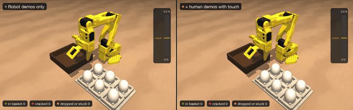

Six eggs that look the same go from a carton to a basket. Some are raw (60 g, the shell cracks above
2.2 N). Some are painted stone (300 g, needs about 3.5 N to carry). A camera can't tell them apart, so
a robot trained on teleoperation demos learns one compromise squeeze: it cracks raw eggs and drops stones.
Add 150 demos from a person wearing a touch glove and the same arm learns to start gentle, feel the
load, and tighten only when the egg turns out to be heavy.

| | eggs moved intact (25 robot demos) |
|---|---|
| robot teleop demos only | 49% |
| + human video, no touch | 42% |
| touch sensor on the robot, robot demos only | 52% |
| **+ 150 human demos with touch** | **93%** |

5 seeds x 60 test eggs per row.

The human grip strategy is fitted to 718 real grasps from a 160-taxel glove dataset. Everything else is
simulated, and the task was built so that looks mislead. Read [Limitations](#limitations) before quoting
a number.

## Contents

- [What's simulated](#whats-simulated)
- [Physics checks](#physics-checks)
- [Results](#results)
- [Limitations](#limitations)
- [Reproduce](#reproduce)

## What's simulated

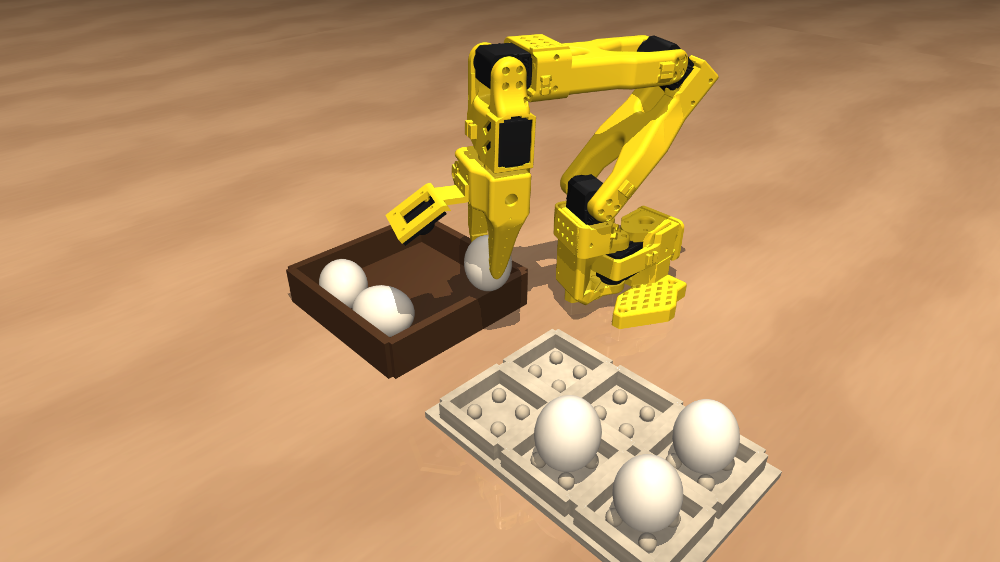

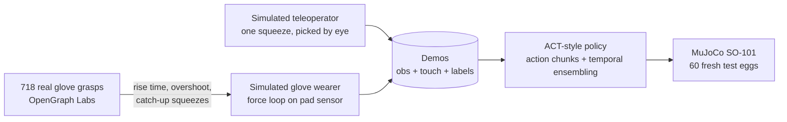

**The scene** (`eggsim/scene.py`) is built with MuJoCo's `MjSpec` API on top of the unmodified SO-101 from
[MuJoCo Menagerie](https://github.com/google-deepmind/mujoco_menagerie). The spec edits are where the
physics lives:

- The jaw's stiff position servo becomes a torque-limited current loop, closed at 500 Hz in the env. Squeeze
  is then a smooth function of the command, like an STS3215 with its P gain turned down.
- Jaw collision geoms get silicone-pad contact: friction 0.8, torsional friction for a 12 mm pad
  (`condim=6`), a soft 20 ms `solref`. Elliptic friction cones and `impratio=10`, because the defaults let a
  held egg creep out of a correct grip (see below).
- Native `touch` sensors sit on box sites over each jaw's contact patch, placed from 3,300 measured
  contact points. An `actuatorfrc` sensor stands in for the servo's current reading.
- Eggs are free-jointed ellipsoids with per-reset mass, inertia and radius. A raw egg cracks when the
  33 ms average squeeze passes its threshold: it is swapped at runtime for yolk, white and shell bodies
  that inherit its pose and velocity.

**Sensing.** Squeeze (smaller of the two jaws' normal-force sums), load (vertical force the jaws carry) and
slip (egg speed relative to the gripper) come from `mj_contactForce` and `mj_objectVelocity`, averaged over
each 33 ms control step. The arm is driven through damped least-squares IK on `mj_jac`.

**Demonstrators** (`eggsim/demos.py`). The teleoperator can't feel the egg: each demo closes the jaw to one
depth picked by eye, and only 28% of attempts succeed (failures are thrown away, as labs do). The glove
wearer runs a force loop on the pad sensor with a grip profile fitted to real human data: a gentle first
squeeze, grip that follows the felt load with a safety margin, and catch-up squeezes on slip.

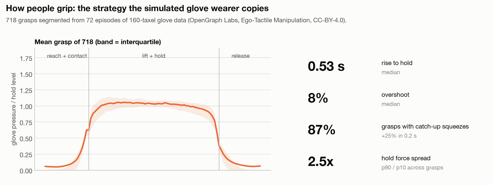

**Policies** (`eggsim/policy.py`). A 3-layer MLP predicts chunks of 8 future actions from two stacked
observations (pinch point, jaw angle, egg position with 3 mm noise, previous action, and touch when the
condition has it). At run time overlapping chunks are blended with ACT-style temporal ensembling. One
policy per condition, data size and seed; each is tested on 60 fresh eggs.

## Physics checks

`python -m eggsim validate` tests the contact model on its own before trusting any learning result.
Details in [docs/physics.md](docs/physics.md).

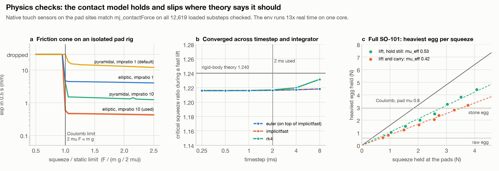

- **a.** On an isolated two-pad rig, the solver settings used here give a clean Coulomb transition: below
  the friction limit the egg falls, above it the egg settles 0.45 mm and stops. With MuJoCo's defaults
  (pyramidal cone, `impratio=1`) an egg held at **twice** the limit still slides 13 mm in half a second.
- **b.** The critical squeeze during a fast lift is the same to 3 decimals from 0.25 to 8 ms timesteps,
  for Euler, implicitfast and RK4, and within 2% of rigid-body theory.
- **c.** On the full robot, the heaviest egg held grows linearly with squeeze, as Coulomb friction should,
  with an effective coefficient of 0.53 holding still and 0.42 while carrying, against 0.8 on the pads.
  That measured envelope sets the task constants: about 3.5 N to carry a stone, against 2.2 N to crack a
  raw egg.

Native touch sensors agree with the contact-force readout on every loaded substep checked, and the env
runs about 13x real time on one core.

## Results

### Touch data from people is worth more than robot data

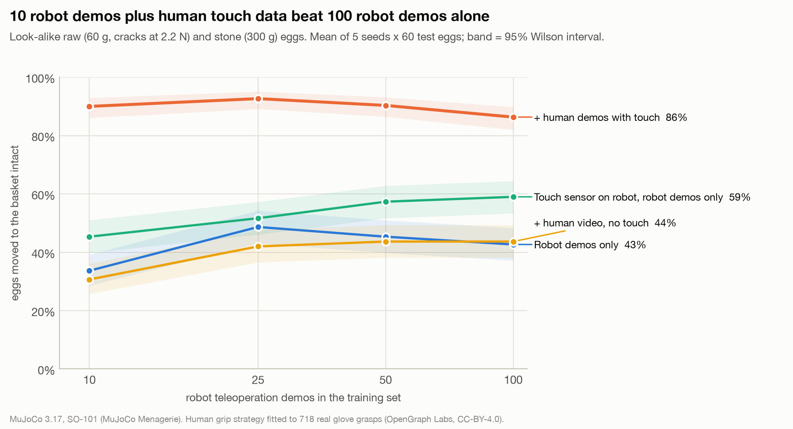

- With 10 robot demos plus the human touch demos, the robot moves 90% of eggs intact. With 100 robot demos
  and no human data it moves 43%.
- More robot-only data stops helping after about 25 demos. Operators squeeze by eye, so their successful raw
  demos are gentle and their successful stone demos are firm. The policy can't see which egg it has, so it
  averages them.
- Human video without touch (B) adds nothing: it teaches the arm path, which the robot demos already cover,
  but not the squeeze.
- A touch sensor on the robot alone (D) climbs slowly to 59%. The robot can feel the weight after lifting,
  but no teleoperator could feel the egg, so the demos never show "it's heavy, squeeze harder".
- The touch condition dips slightly at 100 robot demos (86%, intervals overlapping 25 demos). A likely cause,
  not tested: robot demos are weighted 2x in training, so at 100 they begin to outvote the human squeeze.

### Why: one squeeze can't fit both eggs

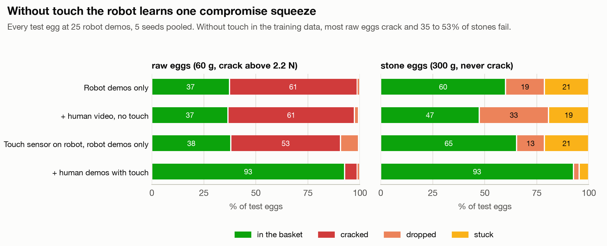

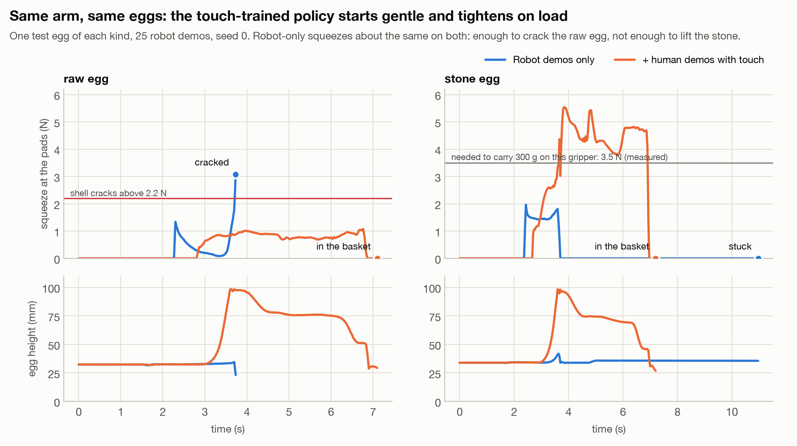

Robot-only policies crack 61% of raw eggs and lose 40% of stones. The two traces above show the pattern:
the robot-only policy grips both eggs at a similar 1.5 to 2 N early on, then squeezes harder on the raw egg
as it lifts and cracks it, while the same grip is about half of what the stone needs. The touch policy closes to under 1 N on the raw egg and holds it there, and on
the stone it keeps tightening as the load comes on, past the 3.5 N the gripper needs.

### Robustness to friction and weight it never trained on

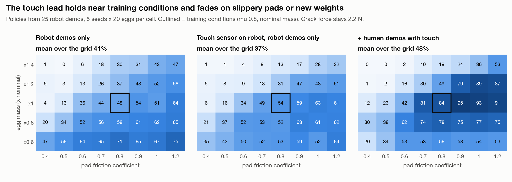

Every policy was trained at pad friction 0.8 and nominal egg mass. The grid changes both at test time (the crack
force stays 2.2 N).

- The touch policy keeps a large lead where pads grip about as well as in training or better. At nominal mass and
  friction 0.7 or above it gets 81 to 95% against 44 to 64% for robot-only. At friction 0.9 or above it also
  holds from 0.8x to 1.2x mass (75 to 95% against 48 to 65%).
- On slippery pads (0.4 to 0.5) every policy fails. A stone there needs more squeeze than the 5 N gripper
  gives, and raw eggs slip out of the grips the policies learned.
- At 1.4x mass every policy stays below 55%. The touch policy drops even raw eggs, which now weigh 84 g,
  likely because it learned a raw-egg grip sized for 60 g, and at friction 0.8 it does worse than robot-only
  (19% vs 30%).
- At 0.6x mass the touch policy also does worse than robot-only (about 53% vs 65%): it cracks most raw eggs
  there. Its grip is tied to the absolute forces it saw in training, the same limit the
  unseen-egg test shows.

The nominal cell reads 84% here against 93% in the main result, on a different set of test eggs: 100 eggs
(95% interval 76 to 90%) against 300 (89 to 95%). The intervals just overlap.

### Eggs it never saw

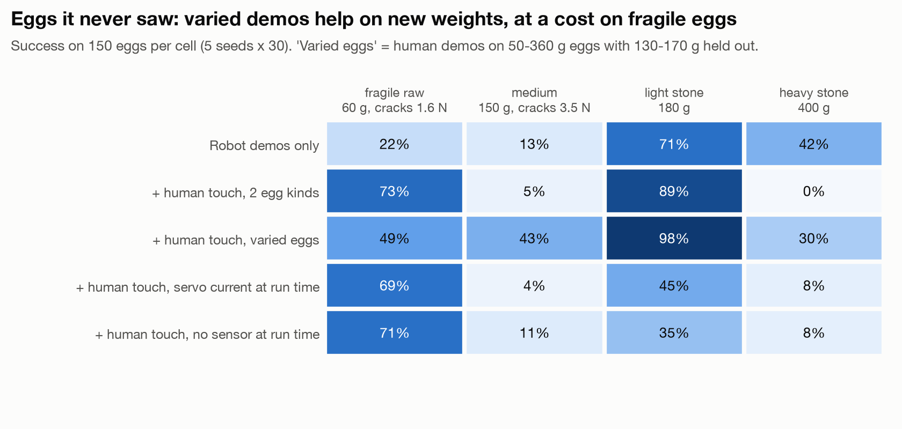

The test eggs here are kinds no policy trained on: a more fragile raw egg, a 150 g egg that cracks at 3.5 N,
a light stone and a heavy one.

- Touch trained on two egg kinds transfers to eggs close to those kinds (fragile raw 73%, light stone 89%)
  and fails on the ones in between or beyond. The 150 g egg gets the raw-egg squeeze and slips (5%). The
  400 g stone gets the 300 g stone's squeeze and drops (0%). The robot-only policy squeezes hard on
  everything, so it does better on the heavy stone (42%) and worse on fragile eggs (22%).
- Human demos on eggs from 50 to 360 g (130 to 170 g held out) lift the medium egg to 43% and the heavy stone
  to 30%. They cost 24 points on fragile raw eggs, nearly all cracks, so the policy grips harder overall.
- Without a touch sensor at run time the policy can't feel the weight, and the stones fall (35% and 8%).

### What else limits the touch-trained policy

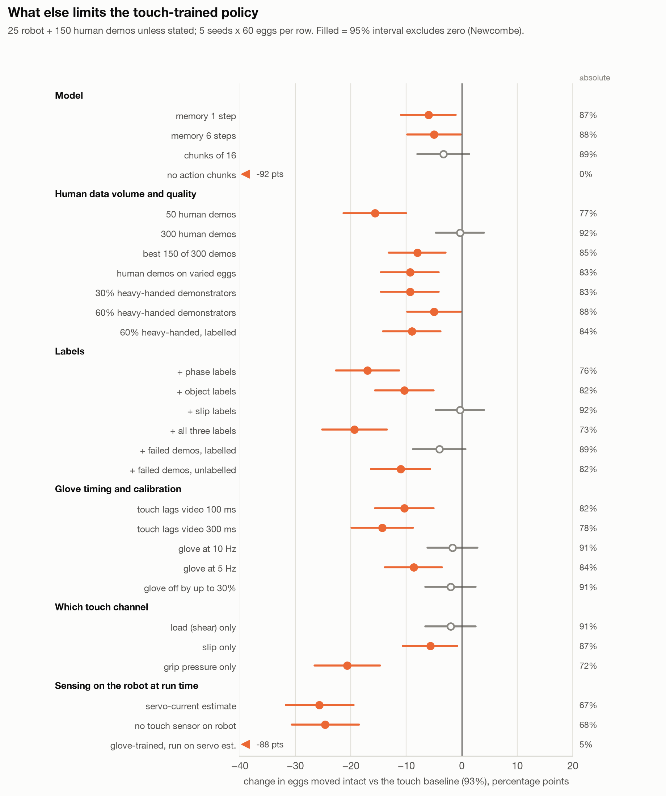

Each row changes one thing about the 93% touch policy and retrains 5 seeds.

- **Action chunks are required.** Predicting one action at a time gets 0%: the arm moves to the egg and stops.
  Both demonstrators hold still for 0.4 to 1 s mid-grasp (median 12 steps for the teleoperator, 28 for the
  glove wearer), and from an unchanging state a one-step policy keeps predicting "hold still". Chunks predict
  past the pause, which is the reason ACT uses them. 8 and 16 steps work the same.
- **The robot needs its own touch sensor.** Trained on glove touch but run without it, or with a force
  estimate from servo current, the policy drops to 67 to 68%. A policy trained with the glove signal and run
  on the servo estimate gets 5%: it cracks nearly every raw egg and can't tighten on stones. Train on the
  signal the robot will have.
- **Load is the useful channel.** Load (shear) alone gets 91%, the same as all three. Grip pressure alone
  gets 72%, because squeeze doesn't change with egg weight until the egg slips.
- **150 human demos is enough.** 50 gets 77%, 300 gets 92%. Keeping the "cleanest" 150 of 300 (fewest slips,
  shortest) does worse (85%) than a random 150. A likely reason: clean demos rarely show the catch-up squeeze
  after a slip, so the policy never learns to recover.
- **Glove sync matters more than calibration.** Touch lagging video by 100 ms costs 10 points, 300 ms costs
  14. A 5 Hz glove costs 9; 10 Hz is fine. A force calibration off by up to 30% per session costs nothing
  measurable.
- **Extra labels mostly hurt.** Training extra prediction heads on phase or egg kind costs 10 to 17 points, all
  three together 19; slip labels are neutral. With a model this small the extra heads seem to compete with
  the action head rather than help it. Failed demos cost 11 points unless they are marked as failures and
  the policy is asked for a success at run time.
- **Heavy-handed demonstrators** (who start at 1.7 N instead of a gentle touch and keep a larger margin) cost 5 to 9 points at 30 to 60% of the
  data, and marking them doesn't help.
- **Robot-only policies stay stuck** at 49% with egg-kind labels (54%) or 6 steps of memory (49%).

## Limitations

- **Not real robot data.** The glove wearer is a scripted controller whose grip parameters come from real
  glove recordings. Arm motion is minimum-jerk, not recorded human motion, and retargeting from a hand
  to a two-jaw gripper is modelled as small position noise.
- **The look-alike gap is designed in.** The task was chosen so vision can't tell the eggs apart. On tasks
  where vision is enough, touch will add much less.
- **The robot has the glove's sensor.** Condition C assumes pad sensors on the SO-101 that report the same
  squeeze, load and slip as the glove. The ablations test what happens without them, but a real SO-101 has
  only servo current.
- **Contact is approximate.** Eggs are rigid ellipsoids with a force threshold scaled to the SO-101's
  5 N gripper (a real shell takes roughly 10x more). Pad friction, compliance and jaw inertia are assumed.
- **State, not pixels.** Policies see egg position directly, not camera images.

## Reproduce

```bash
uv venv --python 3.12 && uv pip install -e ".[dev]"
scripts/download_data.sh                  # 18 MB of glove data (CC-BY-4.0)
python -m eggsim human-grip               # grip statistics -> results/human_grip.json
python -m eggsim collect                  # demos -> data/ (about 6 min on 10 cores)
python -m eggsim gain                     # 80 policies (about 2.5 h on 10 cores)
python -m eggsim ablations                # 160 policies (about 3.5 h)
python -m eggsim robustness               # 12,000 test eggs (about 20 min)
python -m eggsim validate                 # physics checks
python -m eggsim figures && python -m eggsim render
pytest -q
```

Sweeps resume where they stopped. `results/` holds every number behind the figures, so
`python -m eggsim figures` works without re-running anything.

```
eggsim/
  scene.py        MjSpec model: robot edits, pads, sensors, carton, eggs
  env.py          EggEnv: IK, jaw current loop, contact readout, crack model
  demos.py        teleoperator and glove-wearer demonstrators
  collect.py      demonstration datasets
  policy.py       dataset building, ACT-style policy, evaluation
  experiments.py  gain sweep, ablations, robustness grid
  validate.py     physics checks
  figures.py      every figure, one visual system
  render.py       video, gif, hero still
docs/physics.md   modelling notes
```

## Credits

- SO-101 model: The Robot Studio, via MuJoCo Menagerie (Apache-2.0). Unmodified in `assets/so101/`.
- Human glove data: OpenGraph Labs, *Ego-Tactile Manipulation* (2026), CC-BY-4.0. Only derived statistics
  are committed.
- Related work: Adeniji et al., *Feel the Force* (2025), tactile glove demos to force-aware robot policies;
  Zhao et al., ACT (2023), action chunking with temporal ensembling.

Code is MIT-licensed. Built by [Geoffrey Bian](https://geoffreybian.github.io).
